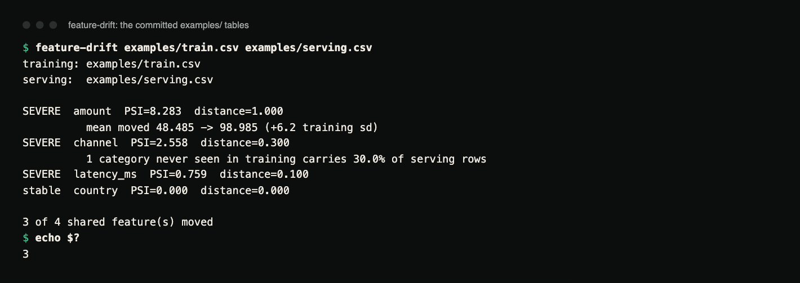
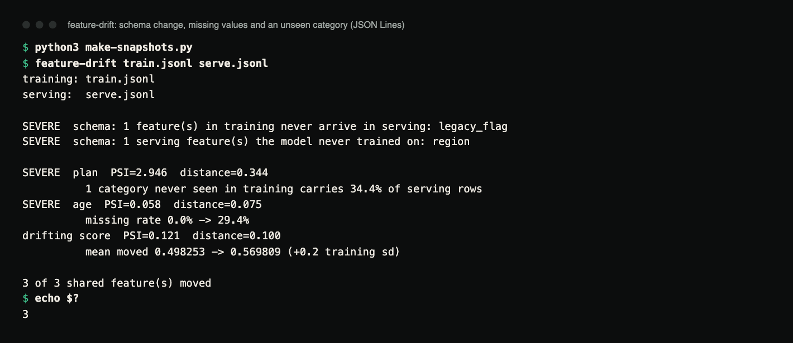

# feature-drift

Detect feature drift between training and serving data, and report **which
features moved and by how much**, in metrics a reviewer can check rather than
a blended score. No runtime dependencies: Python 3.10+ and nothing else.

[](https://github.com/hellpuffyt/feature-drift/actions/workflows/ci.yml)
[](LICENSE)

**Status:** version 0.1.0, beta. CI runs the tests on Linux, macOS and Windows
with Python 3.10 to 3.13. Not published to PyPI; install from a clone.

## Demo

```console
$ feature-drift examples/train.csv examples/serving.csv
training: examples/train.csv
serving:  examples/serving.csv

SEVERE  amount  PSI=8.283  distance=1.000
          mean moved 48.485 -> 98.985 (+6.2 training sd)
SEVERE  channel  PSI=2.558  distance=0.300
          1 category never seen in training carries 30.0% of serving rows
SEVERE  latency_ms  PSI=0.759  distance=0.100
stable  country  PSI=0.000  distance=0.000

3 of 4 shared feature(s) moved
$ echo $?
3
```



*Terminal capture of the run above on the committed `examples/` (real output,
rendered from the saved transcript).* The example files are small, so PSI
values are large: an empty bucket is floored at 0.0001, which weighs heavily
when a share is 10% on one side and 0 on the other.

A larger, generated pair in JSON Lines shows the other checks: a column that
vanished, a new column, a feature that is suddenly null 29% of the time, and
a new category.

<details>
<summary><code>make-snapshots.py</code> (500 rows each, seeded)</summary>

```python
import json, random
r = random.Random(1)
with open("train.jsonl", "w") as f:
    for _ in range(500):
        f.write(json.dumps({"age": round(r.gauss(40, 8), 1), "plan": r.choice(["free", "pro"]),
                            "score": r.random(), "legacy_flag": 1}) + "\n")
with open("serve.jsonl", "w") as f:
    for _ in range(500):
        f.write(json.dumps({"age": None if r.random() < 0.3 else round(r.gauss(40, 8), 1),
                            "plan": r.choice(["free", "pro", "team"]),
                            "score": r.random() + 0.05, "region": "eu"}) + "\n")
```

</details>



*Terminal capture of `python3 make-snapshots.py` and
`feature-drift train.jsonl serve.jsonl` (real output). `age` keeps a low PSI
because its present values did not move; it is severe because of the
missing-rate jump alone.*

## What it measures, and why these

- **PSI** (Population Stability Index) per feature, the common vocabulary:
  under 0.1 stable, 0.1 to 0.25 drifting, 0.25 or more severe. Numeric
  features are split into 10 buckets at the *training* sample's quantiles,
  so serving is judged against where training's mass actually sat.
- **KS statistic** (numeric) / **total variation distance** (categorical),
  both bounded in [0, 1], so the number means the same thing for a latency
  column and a price column. Shown as `distance`.
- **Missing-rate delta.** A feature that is suddenly null half the time has
  drifted in the way that matters most, even when its non-null values look
  identical. A change of 5 points or more is drifting; 20 points or more is
  severe on its own.
- **Unseen categories:** values the model never trained on, with the share of
  serving rows they carry. Any unseen category makes the feature at least
  drifting.
- **Mean shift** (numeric): noted in training standard deviations when the
  mean moved by at least 0.1 sd.
- **Schema changes:** a column that vanished or appeared is reported as
  exactly that, and is severe by itself. Force-fitting it into a drift row
  would bury it.

**No p-values, deliberately.** At production sample sizes everything is
"significant"; the question a drift report answers is *how much moved*.

## Input

Two tables, training/reference and serving/current, as CSV (with a header
row) or JSON Lines (`.jsonl` or `.ndjson`, one object per line). The format
is chosen by file extension. A column is numeric when every present value
parses as a finite number. Empty values and `NA`, `N/A`, `NaN`, `null`,
`None` (any case) count as missing rather than turning the column
categorical. A column typed differently on the two sides is compared as
categories, with a note saying so. A CSV header that repeats a column name is
refused.

## Usage

```console
feature-drift train.csv serve.csv
feature-drift train.jsonl serve.jsonl --format json   # machine-readable
feature-drift train.csv serve.csv --fail-on drifting  # stricter gate
feature-drift train.csv serve.csv --fail-on never     # report only, always exit 0
```

Exit codes are the monitoring interface: `0` nothing at or above `--fail-on`
(default: `severe`), `1` unreadable or malformed input, `2` invalid
command-line usage, `3` drift at or above `--fail-on`.

`--format json` prints an object with `train`, `serve`, `features` (one
entry per shared feature with `feature`, `kind`, `verdict`, `psi`,
`distance`, `missing_rate_delta`, `unseen_categories`, `notes`),
`only_in_training`, `only_in_serving` and `summary`.

## Install

Not published on PyPI; install from a clone (Python 3.10+, no runtime
dependencies):

```console
git clone https://github.com/hellpuffyt/feature-drift && cd feature-drift
python3 -m venv .venv && . .venv/bin/activate
pip install .
```

## Verification

PSI, KS and total variation were checked against NumPy and
`scipy.stats.ks_2samp` on 1,000 random sample pairs (max absolute difference
≤ 1e-15), and against hand-computed values in `tests/test_stats.py`. SciPy and
NumPy are not dependencies; they were only used for that check.

## Development

```console
pip install -e ".[dev]"
pytest          # 67 tests
ruff check .
mypy            # strict
```

CI runs the same commands. See [CONTRIBUTING.md](CONTRIBUTING.md) and
[CHANGELOG.md](CHANGELOG.md). Security: see [SECURITY.md](SECURITY.md).
Audit evidence: [docs/PRODUCTION_READINESS.md](docs/PRODUCTION_READINESS.md).

## License

MIT, see [LICENSE](LICENSE).
